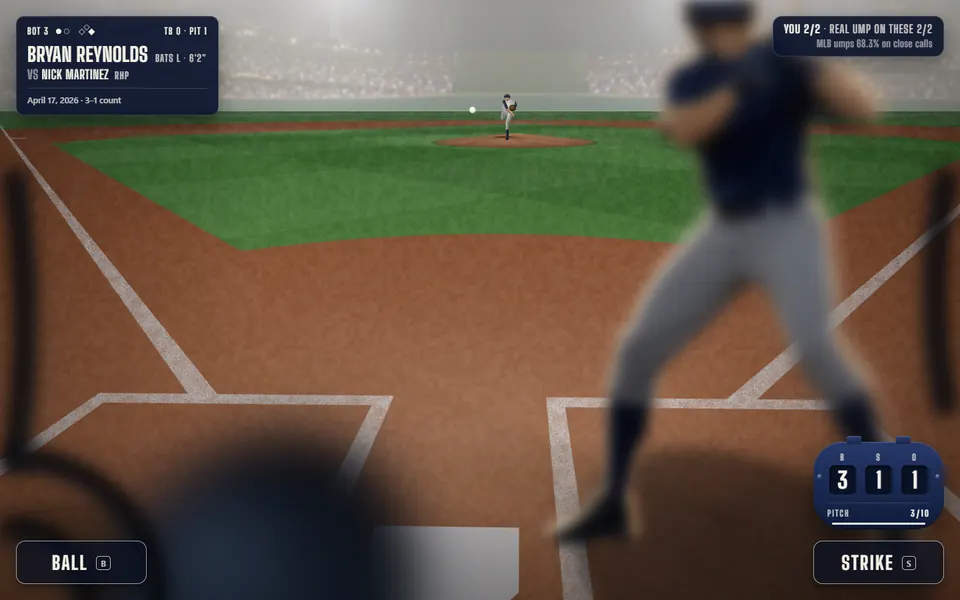
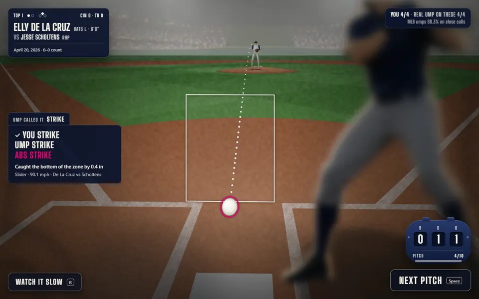
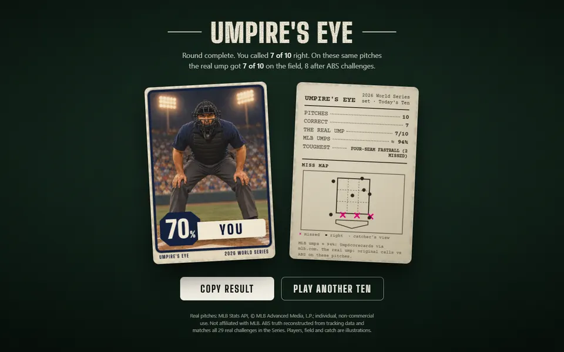

# Umpire's Eye

Call real MLB pitches from the plate umpire's eye, at real speed. Then see the ABS call, what the real umpire called, and your umpire card.

| A pitch on its way | The reveal | Your umpire card |
| --- | --- | --- |
|  |  |  |

## How to play

- Press **Play ball**. Ten real pitches from the 2026 MLB season come in one at a time, along each pitch's tracked flight and at its real speed, seen from where the plate umpire stands.
- Call each pitch: **S** or **→** for a strike, **B** or **←** for a ball, or tap **Strike** or **Ball**. The call window opens when the ball leaves the pitcher's hand and closes 1.5 s after the catch; if it runs out, the pitch counts as a miss.
- Then the reveal: the ABS call (our reconstruction of the zone MLB uses for challenges), the call the real umpire made, and yours. **Watch it slow** (**R**) replays the pitch at a quarter of its speed, and **Next pitch** (**Space** or **Enter**) goes on.
- After ten pitches comes your umpire card: your calls against the real umpire's on the same pitches, and against how often MLB's umpires got the close ones right.
- **Today's Ten** is the same ten for everyone whose clock shows the same date, and it changes at local midnight. **Another ten** deals a fresh set from the season, and never a pitch held back for a future Today's Ten.

The ABS call is our reconstruction, and the players, field and catch are illustrations. [How it works](docs/HOW-IT-WORKS.md) explains the whole path, from MLB's Stats API to the pixels.

## Build and run it locally

You need Node 22.18 or later.

```sh
npm ci
npm run dev             # http://localhost:5173
npm run build           # a static site in dist/, with relative URLs, so it works from any folder
npm run preview         # serves dist/ at http://localhost:4173
```

## The data

The pitches come from the MLB Stats API, © MLB Advanced Media, L.P., whose terms say: "Only individual, non-commercial, non-bulk use of the Materials is permitted and any other use of the Materials is prohibited without prior written authorization from MLBAM." ([source](https://gdx.mlb.com/components/copyright.txt))

- **The 2026 season** (`public/data/season-2026/`) is built by the data tools in `tools/data/`. To rebuild it from the Stats API (`docs/DATA.md` has the details):

  ```sh
  npm run data:fetch      # once: downloads the season into a local cache (about 2,500 requests, 263 MB)
  npm run data:build      # rebuilds public/data/season-2026 from the cache (about 20 s)
  npm run data:daily      # refreshes Today's Ten for the build, keeping its history
  npm run data:validate   # checks the files, and that a rebuild from the cache reproduces them byte for byte
  ```

- **The 2026 World Series pool** (`?pool=ws`) is a committed snapshot of the Series' five games: `art/data/ws-2026-pool.json`, which `npm run assets` minifies into `public/data/ws-2026/pool.json`. Nothing in this repo rebuilds it from the Stats API.

## Test it

```sh
npm run lint            # ESLint, and a check that package-lock.json resolves only from registry.npmjs.org
npm run typecheck       # strict TypeScript over the app, tests, configs and data tools
npm test                # Vitest unit tests, then the data tools' tests
npx playwright install chromium webkit   # once
npm run e2e             # Playwright browser tests; pass specs or flags after --
```

- The browser tests run on desktop Edge and WebKit, and on an iPhone and a Pixel in device emulation, with WebKit standing in for Safari. Outside CI, the Chromium projects use the installed Microsoft Edge (`channel: 'msedge'`).
- `parity` compares the app with the design reference page in `tests/reference/` pixel for pixel, in the same engine, and `speed-edge` and `speed-webkit` count the work each frame of a live pitch does.
- `npm run e2e` builds and serves its own copy of the app on port 4173, or on `UE_E2E_PORT`. It holds a lock file in the OS temp folder, so runs on one machine take turns; the lock is skipped when `CI` is set.

The workflows in `.github/workflows/` (checks, and a GitHub Pages deploy) run only when started by hand.

## URL switches

| Query | Shows |
| --- | --- |
| `?state=pitch&i=3&t=0.2` | Pitch 3 of Today's Ten, frozen 0.2 s after release (`t` may be negative: the windup). |
| `?state=reveal&i=4&call=strike` | The reveal for pitch 4 after a strike call. |
| `?state=card&correct=8` | The umpire card for a round with 8 right. |
| `?selftest=1` | The self-test report, on the World Series pool. The page title becomes `SELFTEST PASS` or `SELFTEST FAIL`. With `?pool=season`, or a `?pool=` the app doesn't know, it checks the season's Today's Ten for the date instead, without the checks that need the whole pool. |
| `?pool=ws` | The 2026 World Series pool, as in the design reference. Without a `?pool=`, or with a value the app doesn't know, it plays the 2026 season (`?pool=season`). |
| `?date=2026-11-14` | Today's Ten for that date rather than the local one, and no switch at midnight. Anything that isn't a valid date is ignored. A date without a Ten offers Another ten instead. |
| `?canvasFilter=fallback` | Draws the depth of field without the canvas `filter`, as WebKit does. |
| `?timing=1` | A plain-text readout over the scene, for checking a real phone: how long each new stance's static layers took to paint, and the KB the page has loaded so far. |
| `?work=1` | Puts the count of static paints on `window.ueWork`, for the speed test. Nothing shows. |

## Project layout

- `src/`: the app, in Vite and strict TypeScript, with canvas 2D and plain DOM and no UI framework. `src/core/` is the pure code it shares with the data tools.
- `tools/data/`: the data tools, which build `public/data/season-2026/`.
- `art/`: the masters for the shipped images and fonts, and the World Series pool. `npm run assets` rebuilds the shipped files from them.
- `tests/`: unit tests, browser tests, and the design reference page.
- `docs/`: [How it works](docs/HOW-IT-WORKS.md) and [the data](docs/DATA.md). `PRODUCT.md` says who the game is for and what it values.

## Credits

- **Pitch data:** the MLB Stats API, © MLB Advanced Media, L.P., under the terms quoted in [The data](#the-data). Umpire's Eye is a free fan project. Not affiliated with MLB, or endorsed by MLB or any team; it uses no logos or player likenesses.
- **Fonts:** Big Shoulders Display and Courier Prime, under the SIL Open Font License (`art/fonts/`).
- **Art:** the backdrops, the batter and the card art are AI-generated, with OpenAI's image model.

## Licence

- The code, and the AI-generated art (the images in `art/` and the copies built from them), are under the MIT licence: see [LICENSE](LICENSE).
- The fonts are under the SIL Open Font License; its texts are in `art/fonts/`.
- The pitch data, and the screenshots in `docs/img/` that show it, fall under MLB's terms, quoted in [The data](#the-data).