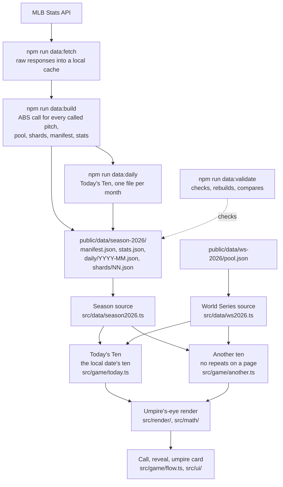

# How Umpire's Eye works

Umpire's Eye puts you behind home plate. Real pitches from the 2026 MLB season come in on their tracked paths, at real speed, from the plate umpire's eye. You call ball or strike, then see the ABS call (our reconstruction), the real umpire's call and, after ten pitches, your umpire card. This page follows a pitch from MLB's Stats API to the screen; `docs/DATA.md` documents the data in full.

## What's real and what's ours

- **Real**, from MLB's feed: each pitch's tracked flight, speed and release extension, the batter's zone, the final call, and any ABS challenge and its outcome.
- **Ours:** the ABS call and its margin, reconstructed from the tracking, not MLB's official ABS output; every data file and the app's footnotes say so. We also derive the umpire's original call on an overturned pitch (the opposite of the final call), and rebuild each pitch's game state from the play log.
- **Illustrations:** the players, the field and the catch, with no MLB or team logos and no player likenesses. The images are AI-generated; `npm run assets` (`scripts/build-assets.mjs`) builds the shipped copies, in `src/assets/` and `public/`, from the masters in `art/`. The fonts, Big Shoulders Display and Courier Prime, are under the SIL Open Font License, whose texts are in `art/fonts/` and ship in `public/fonts/`.

Data: MLB Stats API, © MLB Advanced Media, L.P. Every response links to MLB Advanced Media's terms, which say:

> "Only individual, non-commercial, non-bulk use of the Materials is permitted and any other use of the Materials is prohibited without prior written authorization from MLBAM." ([gdx.mlb.com/components/copyright.txt](https://gdx.mlb.com/components/copyright.txt))

Not affiliated with MLB.

## The pipeline



The data tools build the files locally from the Stats API, and the app reads whatever `public/data/` holds.

## Building the data

The tools in `tools/data/` run on Node 22.18 or later:

```sh
npm run data:fetch     # download into a local cache
npm run data:build     # judge every called pitch; write the pool, shards, manifest and stats
npm run data:daily -- --from 2026-11-01 --through 2028-12-31   # schedule Today's Ten (first run)
npm run data:validate  # check every file, then rebuild and compare
```

`tools/data/fetch.ts` downloads the teams, the schedules with their umpires, every completed game's play-by-play and the players' heights: 2,483 requests for 2026, retried with growing waits. Responses are cached gzipped outside the repository (`tools/data/lib/cache.ts`), in `UE_CACHE_DIR` or by default under `%LOCALAPPDATA%` on Windows and `$XDG_CACHE_HOME` or `~/.cache` elsewhere. Nothing cached is fetched twice, and the build reads only the cache.

### The reconstructed ABS call

The 2026 season has 362,177 called pitches: balls and called strikes with full tracking. For each, `tools/data/lib/judge.ts` uses the shared `src/core/kinematics.ts` and `src/core/abs.ts` to find where the ball's centre crosses mid-plate, then calls a strike if any part of the ball (radius 1.45 in) touches the zone there: 17 in wide, between the feed's `strikeZoneTop` and `strikeZoneBottom` (about 53.5% and 27% of the batter's height). `marginIn`, stored to 0.01 in, is how far the ball would have to move to flip the call, positive for strikes.

Why mid-plate? Judged there, the reconstruction agrees with the final call on 10,748 of the season's 10,749 ABS challenges. At the front of the plate, where the feed's own `pX` and `pZ` sit, it would match only 9,139 (85.02%).

### Close, near and calibrator

Bands go by the size of the stored margin (`src/core/rules.ts`), so the season totals, the pool and the app always agree:

| Band | Inches from flipping the call | In a round of ten |
| --- | --- | --- |
| Close | 1.5 or less | eight pitches, at least one ABS-challenged |
| Near | over 1.5, up to 4.5 | one pitch |
| Mid | over 4.5, under 6 | none |
| Calibrator | 6 or more | the first pitch, a clear call |

A pitch is *dealable* only if the app can show it as it happened. Among other things, it must cross inside the deal box (0.9 to 4.5 ft up, within 1.5 ft of the plate's centre line), which the camera always frames, and reach the plate within 0.6 s of release, so it can't arc out of frame.

### Pool, shards and files

A round is mostly close calls, so the build keeps a pool (`tools/data/lib/pool.ts`): all 59,810 dealable close calls, 7,476 each of near calls and calibrators, and every challenged pitch, 74,847 in all. It splits them into 22 shards of 3,402 or 3,403 (`tools/data/lib/pipeline.ts`), each holding its share of every kind of pitch, to within one, and fails if any shard can't deal 200 full tens. Beside `shards/`, `public/data/season-2026/` holds:

- `manifest.json`: the rules, the pool's make-up, each shard's size and sha256, and the Today's Ten schedule;
- `stats.json`: season totals over every called pitch, including `umpVsAbs`;
- `daily/YYYY-MM.json`: a month of Today's Ten, in a shard's format so that one decoder (`src/core/decode.ts`) reads both.

Every file carries the data credit and a build id, a hash of the shards and stats. The same cached responses always give byte-identical files: the seed is fixed, nothing is timestamped, and the shard count comes from a fixed size (3,500 pitches at most) rather than gzip sizes, which differ between zlib builds.

### Today's Ten, scheduled ahead

`npm run data:daily` (`tools/data/lib/daily.ts`) picks each date's ten ahead of time; the arguments above give 792 days in 26 month files.

- **Reserve.** Pitches whose IDs hash below 0.25 (`isDailyReserve` in `src/core/daily.ts`), 18,725 dealable ones, are held back for it. The rule rests on the ID alone, so the tools, the app and every rebuild agree, and Another ten never deals a pitch someone will meet on a later date.
- **Deal.** The shared dealer (`dealTen` in `src/core/deal.ts`), seeded with `umpires-eye-2026|today|<date>`, deals a calibrator, then eight close calls and a near call in played order. Five variety rules (`varietyProblems`) require ten different games, three or more batters from each side, two or more pitch families, a two-strike or three-ball count, and at most three challenged close calls. A ten that breaks one is redrawn from the same seeded stream, so a date always gets the same ten.
- **Lock.** Each run reads the month files first. A date on or before `servedThrough`, the last date anyone may have played, keeps its ten; if a rebuild loses one of its pitches, the day becomes unavailable. No pitch is scheduled twice.

### Validation and size budgets

`npm run data:validate` (`tools/data/validate.ts`) reads every shard with the app's decoder, recomputes each pitch's ABS call, checks every size, hash and build id against the manifest, deals 200 tens per shard, and checks Today's Ten rule by rule (`tools/data/lib/daily-check.ts`). Then, given the cache, it rebuilds everything and fails if any file differs by a single byte; the schedule's check mode reproduces the month files byte for byte even without it.

Budgets count gzipped bytes, with 1 KB as 1,000 bytes (`tools/data/lib/constants.ts`):

| What the browser loads | Budget |
| --- | --- |
| One month file | 50 KB |
| As the page opens: the manifest, the largest month file and `stats.json` | 50 KB |
| A session: all that plus the largest shard | 300 KB |

The session budget covers a session within one month. A page left open into a new month adds that month's file, 32.5 to 35.5 KB; one that deals past its first shard adds another shard, about 250 KB.

## The app

`src/` is Vite and strict TypeScript, with no UI framework.

### Sources and the shared core

The game reads pitches only through a `PitchSource` (`src/data/source.ts`), which gives a date's Today's Ten (or why there's none), a deck for Another ten, the crossings the camera must frame, and the umpires' figure. `src/data/sources.ts` picks one by `?pool=`. The default is the 2026 season (`src/data/season2026.ts`, reading `public/data/season-2026/`); `?pool=ws` plays the 742 called pitches of the 2026 World Series (`src/data/ws2026.ts`, reading `public/data/ws-2026/pool.json`): the design reference's pool, which the parity and speed tests play.

The season source loads the manifest and the date's month file together, `stats.json` alongside, and a shard only for Another ten, all through `src/data/fetch.ts`, which retries network failures. When a file's build id differs from the manifest's, as when a browser kept a stale copy of one across a rebuild, the source fetches the manifest again past the cache and, if they still differ, fetches the file again at the address the fresh manifest gives it.

`src/core/` holds the rules, seeded draws (FNV-1a and mulberry32), trajectory, ABS rule, file formats, dealer and schedule rules, and the data tools import it as is under plain Node. So a seed draws the same pitches in the browser and the tools, and both judge a pitch alike. Lint and `src/core/tsconfig.json` keep core free of the DOM, Node, Vite and `Math.random`.

### Today's Ten

The page plays the ten for the player's local date (`dateKeyOf` in `src/core/daily.ts`), so everyone whose clock shows the same date gets the same ten, and it changes at local midnight rather than UTC's. `?date=YYYY-MM-DD` picks a date and ignores the clock. On the start screen, `watchMidnight` (`src/game/today.ts`) fires as the next local date begins, and checks again whenever the page comes back into view, since a sleeping device can hold a timer past midnight. A round keeps the date it began on. A date outside the schedule, or made unavailable by a rebuild, offers Another ten instead.

### Another ten

`src/game/another.ts` deals with the same core dealer and round rules, seeded afresh each time. It leaves out Today's Ten and every pitch already dealt on the page, and the season's decks hold none of the daily reserve. When a deck can't deal a full ten, a shard the page hasn't used takes over; once every shard has run dry, the page forgets what it dealt and starts over. The first shard loads while you read the start screen, or, if the device asks to save data, only when you ask for Another ten. It's never parsed during a pitch.

### The umpire's eye

`src/render/` draws the scene on one canvas, from the pure math in `src/math/`.

**Camera and stance.** The eye sits 4.15 ft up, 3.7 ft behind the plate's back tip and 0.62 ft toward the batter (`src/math/constants.ts`). Each plate appearance shifts it by up to 2 in either way across, 3 in nearer to or farther from the mound, and 2 in up or down, its height loosely following the batter's; each pitch adds up to 0.75 in more each way. The plate appearance and the pitch seed their own shifts (`src/math/stance.ts`), so you can't learn where the zone sits on the screen.

**Lens fit.** `src/math/lens.ts` fits one lens per screen size and batter side, so that every crossing the game can deal stays in frame from all eight corners of the stance range. Between pitches only the eye moves. The season's lens fits the deal box's edges, so it never shifts with the shard in play.

**Static layers.** The back layer (sky, far stands, infield, lights and batter) and the front layer (catcher and mask) are painted off screen once per stance (`src/render/scene.ts`). Each frame draws the back layer, the pitcher, the mitt, the front layer and the ball. Once a reveal settles, the next pitch's layers are painted ahead, so Next pitch is a swap, not a stall.

**Depth of field.** One lens, focused on the mound, blurs by distance: σ = F × 0.077 × |1/d − 1/60| px, for depth d in feet and focal length F in pixels (`src/math/dof.ts`). The pitcher stays sharp, and the ball is never blurred, since your eye tracks it.

**Without canvas `filter`.** Every blur and colour grade goes through `withFilter` (`src/render/filter.ts`), which uses canvas `filter` where the engine applies it. WebKit, and so Safari, doesn't, so there the block is drawn on a scaled-down work canvas, blurred (with an exact Gaussian, or `drawImage` taps when the canvas is too big for that), colour-graded and scaled back up. `?canvasFilter=fallback` forces this path anywhere.

**The mitt** is the only blurred thing drawn every frame, so the fallback might read pixels back every frame. But the catcher sets up low on the pitcher's target and moves only in the last 50 ms before the catch, so `withFilter` keeps the mitt's blur while it holds still and reuses it, reading nothing back. Moving that late also means the glove never leads the ball.

**The ball** flies its tracked path in real time, crisp and on top: real seconds since release map straight onto the trajectory.

### Calling it

The call window opens at release and closes 1.5 s after the catch (`src/math/flow.ts`), while a line on the umpire's indicator drains. Press S or → for a strike, B or ← for a ball, or tap. A press before release just shows "Wait for the pitch"; no call by the end shows "No call" and counts as a miss. Calls are graded against the ABS reconstruction.

### The reveal

Once the catch settles (`src/render/reveal.ts`), the scene dims, the ABS zone draws itself in chalk at true size at mid-plate, dots trace the path from release, and a magenta ring marks the ball where it crossed. The verdict (`src/ui/verdict.ts`) sets your call beside the real umpire's original call and the ABS call, names any challenge and its outcome, and gives the margin in inches. Watch it slow (R) replays the pitch at a quarter speed.

### The card and the ump figure

The umpire card (`src/ui/card.ts`) shows your score, the real umpire's original calls on the same ten against the reconstruction, your toughest pitch type or location, and a miss map in the catcher's view.

The umpires' figure is how often their original calls agree with the reconstruction, from `stats.json`'s `umpVsAbs`, rounded to one decimal (`src/data/season2026.ts`) and worded in `src/math/words.ts`:

- **Season overall:** 337,685 of 362,177 called pitches, 93.24%, shown as 93.2%.
- **Close calls:** 40,933 of the 59,910 called pitches within 1.5 in of flipping the call (worded "within 1.5 in of the zone's edge"), 68.32%, shown as 68.3%.

The hook gives both: "MLB umpires got 93.2% of calls right in 2026, but only 68.3% of the close ones. Can you?" The score chip, the verdict, the card and the copied result set your score against the close-call figure, since eight of each ten are close calls, and the footnotes define both figures. Other sites' figures use their own zones, so they aren't directly comparable.

### Loading and errors

While the date's files load, Play says "Loading today's pitches" and waits (`src/game/states.ts`). A failed load offers Try again, and retries by itself when the device comes back online; data that doesn't read right offers Reload. If the app's own code fails to load, a script in `index.html` turns Play into Reload.

## How it's tested

Besides `npm run lint` and `npm run typecheck`, the tests come in three layers.

### Unit and data tests

`npm test` runs Vitest over `tests/unit/` (core, sources, dealing, dates and the call window), then `npm run data:test`: `node --test` over `tools/data/test/`, on small synthetic seasons rather than recorded MLB responses. One of those, `mockup.test.ts`, checks that the shared ABS math reproduces the World Series pool's 742 pitches and 29 of 29 challenges.

### The self-test

The approved prototype's `?selftest=1` guarantees live on as pure checks in `src/selftest/checks.ts`, from each pitch's recomputed crossing, truth and timing to every dealable crossing in frame at five screen sizes and eight extreme stances. Vitest runs each one and pins the prototype's recorded figures (`tests/unit/selftest.test.ts`). In a browser, `?selftest=1` prints the report and titles the page `SELFTEST PASS` or `SELFTEST FAIL`, on the World Series pool or, with `?pool=season`, the date's season Ten.

### Browser tests

Playwright runs `tests/e2e/` in the projects in `playwright.config.ts`, with WebKit standing in for Safari and, locally, an installed Microsoft Edge for the Chromium projects. `desktop-edge` and `desktop-webkit` play keyboard rounds, Today's Ten by date, the loading and failure states, accessibility, screenshots and the self-test page, on the World Series pool or on a small synthetic season (`tests/fixtures/season-mini.ts`) served in place of the real one. They also check each engine's blurred catcher against Edge's native filter (`native-reference`). `iphone` and `pixel` emulate phones. `parity`, `speed-edge` and `speed-webkit` compare the app with the design reference: the approved prototype, kept at `tests/reference/index.html` and drawing on the masters in `art/`, loaded in the same engine as the app so each comparison is like for like.

**Parity.** `tests/e2e/parity.spec.ts` shoots the reference and the app (on the World Series pool) at eight URL states, from the start screen to the card, at 1440×900, 1024×768 and 390×844 with the same seeded randomness, and compares them pixel by pixel; a pixel differs if any colour channel moves more than 8 of 255 levels. The credit footnotes are masked, since the app's credit differs from the reference's, and by default the reference's take the app's heights so everything else lines up (`UE_PARITY_ALIGN=0` turns that off). **Exact** mode serves the app the PNG masters from `art/` instead of its WebP images, and not one pixel outside the masks may differ. **Shipped** mode keeps the WebP images: the scenes must still match exactly, and the card states may differ on up to 3% of pixels, as the card art is resampled.

**Speed.** Frame times move with whatever else the computer is doing, so `tests/e2e/speed.spec.ts` counts each live frame's work instead. It plays the first pitch through the catch on the reference and on the app with the fallback filter (and the native one, in Chromium), three rounds in turn; `?work=1` makes the app count its static paints, and the test counts `getImageData` read-backs. No frame may repaint a static layer, and a frame may read back only to blur the mitt anew: at most twice (its box, then its blur), in no more than half the frames. As a coarse backstop, the app's median frame gap must stay under twice the reference's, plus 10 ms.

**Running them.** `npm run e2e` (`scripts/e2e.ts`) builds and serves the app and runs Playwright, passing arguments through (`npm run e2e -- --project=desktop-webkit`). It takes a machine-wide lock so runs from any checkout take turns; `npx playwright test` skips it. `UE_E2E_PORT` serves the test build on another port.
